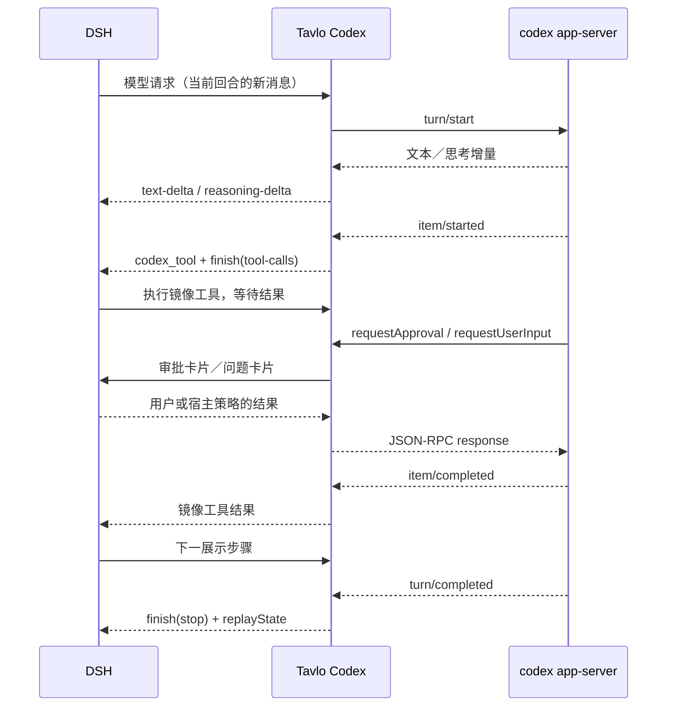

# Codex 接入设计

开发与验收按 [开发计划](implementation-plan.md) 推进；阶段状态与验证记录见 [开发进度](progress.md)。客户端保留 Fast 开关和原生统计；Plan、工具进度、Goal 和子代理沿用命令入口。

## 接入点

与 `tavlo-plugins-claude` 一样，插件通过 `ctx.llm.registerAdapter` 注册模型提供方。DSH 的 agent loop 驱动展示步骤，Codex 的原生 agent loop 在本机进程中执行任务。

选择官方 `codex app-server` 的 stdio JSON-RPC 接口，原因是它提供原生线程生命周期、双向工具审批、用户提问和细粒度事件。这些接口直接对应 DSH 的交互能力。

## 模块职责

| 模块 | 职责 |
| --- | --- |
| `index.ts` | Cordis 配置、服务注入、DSH 注册和进程启动。 |
| `app-server.ts` | JSONL 帧解析、请求关联、服务器发起的请求、超时与进程失败处理。 |
| `spawn.ts` / `executable.ts` | 安全解析本机入口并由 DSH subprocess 服务管理进程，不启动 shell。 |
| `codex-session.ts` | 原生线程和回合状态、输入提交、事件队列、取消、待审批请求和工具结果。 |
| `session-registry.ts` | 跟踪 DSH 回合的新消息 id、会话生命周期与失败进程替换。 |
| `events.ts` / `mirror-args.ts` / `codex-tool.ts` | Codex item 到 DSH 工具卡片与结果的映射，清除大段 base64 载荷。 |
| `permissions.ts` / `questions.ts` | 沙箱／审批结果、原生用户问题及有限的 MCP elicitation 适配。 |
| `models.ts` / `context-window.ts` | 原生模型列表、推理强度、缓存和真实上下文容量。 |
| `auxiliary.ts` | 将标题／摘要路由到普通模型，避免污染原生会话。 |
| `native-state.ts` / `usage-tracker.ts` | 可重放的原生状态投影、累计消耗与独立上下文快照。 |
| `native-controls.ts` / `commands.ts` | 原生模式、名称、Goal 控制及 DSH slash command。 |
| `native-agents.ts` | 子线程身份、父子关系、状态与实际模型信息。 |
| `native-images.ts` / `native-progress.ts` / `native-diagnostics.ts` | 持久图片、有界执行进度和运行诊断。 |

## 状态与消息所有权

每个 DSH 会话只运行一个 app-server。服务启动时先用隔离的一次性 App Server 连接读取完整 `model/list` 并更新菜单缓存，不创建 thread，也不发送 `initialized` 激活完整运行时；模型目录若在无缓存时先查询，会等待这次发现后再返回。真正会话再初始化独立 app-server，发送 `initialize`、`initialized`，然后创建、恢复或分叉 thread。每条真实用户输入只交给 Codex 一次，DSH 的 assistant/tool 记录不会再次作为模型历史提交。

准备中的消息使用独立的 reservation 集合；图片全部读取完毕、取消检查通过后才提交 `turn/start` 并加入已发送集合。明确的 JSON-RPC 拒绝会释放这次消息的标记。传输失败属于结果未知，保留已发送标记，避免重复执行命令。

原生回合跨越多个 DSH 展示步骤。每次顶层工具开始产生一条 `codex_tool`；它只等待结果，不运行命令或写文件。已经收到的工具结果保留到 DSH 消费，工具执行比界面快时也不会丢失记录。普通新消息排队到当前原生回合结束后提交；显式 `/codex steer` 使用 `expectedTurnId` 和客户端消息 id 追加到当前回合，成功后直接记入 DSH 日志，不再入队。明确拒绝可重试，传输结果不明保留提交标记并关闭连接。

已提交消息 id 同步持久化到插件记录；每个 DSH assistant 的 replayState 保留原生边界。进程替换等待旧进程停止，继承检查点和已发送集合；恢复／分叉的身份、模式、统计和可重放插件状态分别处理。分叉清空父线程的代理和工具进度，避免把父子线程身份带入新会话。

未知的服务器请求返回 `-32601`，避免悬挂等待。服务器给出的明确 RPC 错误只拒绝对应请求；无效 JSON、断开和请求超时会使整个连接失败，拒绝所有等待者并终止进程。stderr 只保留有界尾部作为诊断。

## 恢复与分叉

每个 DSH assistant 的 `replayState.response` 保存 `{ codexSessionId, codexTurnId, dshSessionId }`。其中 `codexSessionId` 是 app-server 的 thread id。重启后同属一个 DSH 会话的记录使用 `thread/resume`；属于父 DSH 会话的记录使用 `thread/fork`，明确传入 `lastTurnId`。

原生线程按回合分叉，无法精确截取原生回合中的某一个工具步骤。服务端拒绝未完成边界时向用户显示错误，不降级为向父线程写入。进程替换另外携带已发送消息 id 和已知 thread checkpoint，处理原生已提交、DSH 尚未记录 assistant 的故障窗口。

## 审批和取消

原生沙箱策略在每次提交新回合时从 DSH 的 sandboxPolicy 与 approval 服务读取，支持预设以及派生的 custom 组合和额外可写目录。DSH Auto 依赖宿主工具审查，无法覆盖 Codex 自行执行的工具，因此明确拒绝该预设。审批由 `ctx.approval` 执行；实际配置为完整访问且 never 的预设或 custom 组合可直接放行。仅使用 `accept`，不采用 `acceptForSession` 或持久规则建议。额外权限申请使用 `scope: turn`。

`SessionRegistry` 监听 `permission/preset`、`sandbox/mode` 和 `approval/policy`，在微任务中合并同次选择产生的事件，避免在 session append 观察器内递归写投影。`CodexSession.refreshPermissions()` 串行应用最新设置；原生 0.169.0 的活动回合设置接口不支持沙箱和审批策略，故运行中先取消旧请求并 `turn/interrupt`，等终态、已知子代理停止与 Goal 边界处理完成，再 `thread/settings/update` 和 `turn/start` 接续同一线程。接续只发送权限变化说明，不重发原始消息，保留已完成工具结果及输入去重记录。用户停止、卸载或原生任务自然完成时不续跑；停止超时、配置拒绝或不明确提交失败会关闭进程并暴露错误。空闲时仅更新线程设置，不发起模型回合。

通常审批附着在对应工具的等待期间。没有可镜像 item 的提问或审批会创建一条合成工具记录，保证 DSH 有步骤可以处理交互。子代理请求来自同一受管 app-server，可以由父工具等待期间处理；不错误地把父工具 callId 附给子代理请求。

取消会清空尚未提交的输入、停止处理晚到的输出、取消问题与审批，随后发送 `turn/interrupt`。在 `turn/start` 应答之前发生取消时，获得 turn id 后再发中断。新输入要等中断完成；超过宽限时间则杀掉进程。启动握手期间取消会直接关闭连接。

## 上下文和辅助模型

使用 `thread/tokenUsage/updated.total` 的累计水位差分统计消耗，独立保存 `last` 作为最近模型调用快照。缓存读写 token 从 input token 中拆开，reasoning 为 output 子集，不再次计入总量。容量来自原生 `modelContextWindow`，未知时不生成虚构百分比。

DSH 同一步覆盖标准 usage，并将同一份 usage 同时用于消耗与上下文估算，无法准确承载原生多次调用。因此停止发送标准 usage，使用 `tavloCodex.usage` 和 `/codex usage` 发布权威统计。水位、最近快照和统计边界通过 `plugin:tavlo-codex/state` 持久化；正常恢复沿用已知基线，未知恢复／分叉首通知从 total 减 last 推导历史水位并标记 inferred，此前未观测调用可能少计。重复通知不增加消耗，晚到事件不串回合，累计回退重新建基线。

自动压缩与手动 `/codex compact` 都由 Codex 执行。压缩状态来自 `contextCompaction`，完成后清除旧占用快照、等待新样本；切换模型清旧快照与容量。

DSH 0.2 尚无按 provider 关闭宿主自动压缩的接口，因此 `resolveModel()` 保留大窗口作为宿主压缩保护；`prepareCall()` 仅公开已知的真实容量。原生数据到来时更新当前会话的 `request/context`。

辅助请求交给普通 LLM provider。Codex 与 Claude 原生 provider 不参与自动发现，避免互相转发。仅在输出首个分片前失败时尝试另一条路由。

## Plan、名称与 Goal

初始化启用 `experimentalApi`。Plan 使用 `thread/settings/update` 和后续 `turn/start.collaborationMode`，保留模型与推理强度，不改动 sandbox。接口不可用时保存能力错误，不静默切回 Default。步骤来自 `turn/plan/updated`，方案正文来自 plan item，最终正文覆盖草稿；确认执行先切 Default，再生成一次用户确认输入。

Fast 使用同一会话控制锁，通过 `thread/settings/update.serviceTier` 切换（开启为 `fast`，关闭为 `null`）；不会提交模型消息。`speed.selected` 保存会话选择，优先于插件可选 `fastMode` 默认值，二者均未设置时不发送该字段。新建、恢复、分叉与后续回合均应用选择；响应与 `thread/settings/updated` 更新 `speed.effectiveTier`，把当前 CLI 的 `priority`／`default` 归一化为 `fast`／`null`，其他档位保留原值。原生拒绝时保留此前选择并记录错误。旧日志缺少 `speed` 时按继承模式恢复。

客户端通过 `conversation.input.right` 在模型选择器左侧注册独立 Fast 开关；已发布的 DSH `0.2.2-rc.1` 没有菜单内部的扩展位，因此不依赖或覆盖模型按钮。React 与 Toast 由宿主共享，闪电图标使用内联 SVG，`lib/client.js` 按宿主 ModuleLoader 格式独立打包。选择 Codex 的根会话才显示；模型目录用于识别新会话默认模型。点击通过 `remote.commands.execute` 调用现有命令，检查传输错误、未匹配和 handler 错误；不使用丢弃 handler 结果的 `session.command`。开关只随投影视图更新，不乐观回显；运行、提交或模型切换期间禁用，卸载后的应答不污染下一会话。插件默认值只附加在投影视图的 `fastModeDefault` 中，不持久化部署配置。

统计使用 `conversation.composer.dock` 的插件入口，直接读取 `tavloCodex.usage`，弥补停止通用 usage 上报后原有 token-meter 无数据而隐藏的情况。累计消耗使用 `consumed`，缓存分母包含互斥的未缓存输入、缓存读取和缓存写入；上下文分子使用 `last.totalTokens`，不使用累计消耗。切换模型或压缩后不展示旧上下文样本。`usage.lastTurn` 将输出用量与相同 turn id 的原生耗时配对：优先使用 `durationMs`，为空时由原生 `startedAt/completedAt` 的秒差换算，协议都未提供时才使用插件从 `turn/start` 发出到 `turn/completed` 到达的墙钟差。完成后不带 `turnId` 的用量通知绑定到刚完成且仍处于活动身份的回合；只有正输出 token 和正耗时同时存在才发布速度。UI 明确标为包含工具与等待的回合平均速度。未计时旧记录、未知容量或快照显示占位并解释原因，不从 DSH 镜像工具步骤的耗时推测纯生成速度。每项读数点击打开由 CSS Anchor 定位的统计卡片，采用宿主的主题、圆角、阴影和“标题／分隔线／明细”结构，并支持 Escape 与点击外部关闭；提示气泡仅在窄屏截断读数时作为回退。

会话名称通过 `thread/name/set` 与通知同步。DSH 人工标题固定优先，原生自动名称以 provider 来源填充宿主标题；过滤回声，重命名错误与回合错误独立。session observer 内的同步安排在异步边界，避免递归 append。

Goal 修改前读取权威状态。只有显式 set 传 objective，并初始保存为 paused；状态与预算修改保留已有用量。用户操作使用 origin=user，回合边界暂停使用 automatic。resume 只驱动一个受管 DSH 回合，结束自动暂停；turn/completed 不代表 goal complete。未受管续跑立即中断，暂停失败关闭进程。预算耗尽不能自动解除，增加预算也不自动恢复。

正常释放会话先在有界时间内暂停目标、停止后代，再关闭进程。异常退出保留最后观测状态并注明连接结束，恢复时重新读取原生 Goal、保留预算与用量并暂停遗留 active 状态。边界暂停只作用于当前仍 active 的目标，不覆盖已经 complete、blocked 或受限的状态。活动目标拒绝再次 resume；恢复命令无法提交受管回合时撤回活动执行。Fork 清除父目标快照后读取新线程实际目标。

用户确认不需要额外的 Plan／工具进度／Goal／子代理面板，因此不注册 `conversation.input.dock`。相关状态继续保存在原生投影中，通过 `/codex` 命令查询和操作；现有 Fast 开关与统计底栏保留。

## 子代理、图片与执行状态

代理派发完全由 Codex 完成。`collabAgentToolCall`、`subAgentActivity` 和已知子线程事件汇入稳定代理表。`NativeLifecycle` 在活动期间每秒通过 `thread/list.ancestorThreadId` 有界分页发现后代，按父子关系消解无序结果，再以 `thread/read` 和最近三轮历史核对状态；最多 256 个后代，拒绝重复 cursor 或身份变化。读取期间收到的新事件优先于旧快照。不调用子线程 resume，因此不会为订阅重新激活已卸载线程。

父边界先读取后代，向活动回合发 interrupt，并持续核对直到无活动回合；只有 RPC 应答不足以宣告停止。尚在启动的线程等待 turn id，迟到启动的子代理也会被停止。`cancelGraceMs` 到期或核对失败关闭整个受管进程。断线清空活动 turn id 并标记 connectionLost；恢复重新读取状态，不复活子任务。审批仍沿实际 thread/item 归属处理。

图片输入前读取模型 inputModalities；未知模型保守支持 text。可读绝对路径或直接 base64 图片结果导入 DSH 附件库，有格式与大小限制；仅有 fileId 时显示无法下载。原生 turn 先结束也等待附件存储完成，避免丢失图片工具结果。

工具进度保留 64 KiB 尾部、最多 128 工具和每个 MCP 工具 32 条进度消息，100ms 合并写入插件日志；最终输出替换增量。图片引用、进度、turn diff 与诊断进入持久状态，命令可查询。诊断保留配置警告、MCP 启动、认证、额度、Windows 沙箱与回合错误，不保存账户邮箱或完整配置。

## 验证范围

自动测试验证 JSONL 分片、乱序应答、RPC 拒绝、断开与超时，以及会话去重、进程替换、工具续读、审批、用户问题、恢复／分叉、用量与投影重放、Plan、Goal、代理、图片、进度、诊断和 DSH 真实 LLM runtime 的辅助路由。`scripts/smoke.mjs` 使用隔离临时 Codex home 验证模型、线程、Plan、名称和暂停 Goal，不提交模型请求。

协议字段已核对 `codex-cli 0.169.0` 的实验类型，并参照[官方接口文档](https://learn.chatgpt.com/docs/app-server)。真实 DSH headless 文字回合、真实 Codex Goal 跨回合和子代理停止／重启均有验证记录，见 [本轮验证](workspace-verification.md)。此前通过浏览器验收的四项工作面板已按用户反馈撤下。其余图片、恢复／分叉的完整界面组合与旧 CLI 兼容仍单独跟踪。
